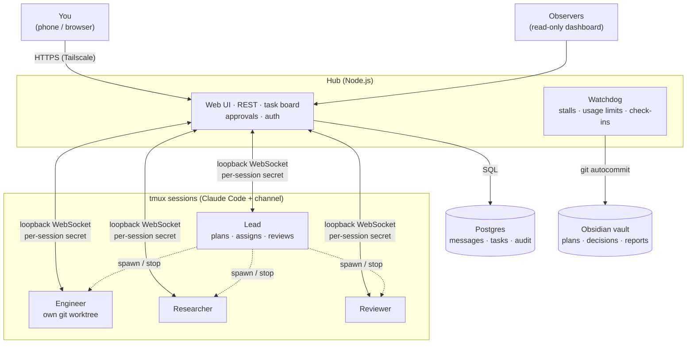

<div align="center">

# cc-hub

**Give one Claude a problem. It plans the work, staffs a team of Claude Code sessions, runs them for days, and reports back to your phone.**

[](https://github.com/Roenan-b/cc-hub/actions/workflows/ci.yml)
[](https://github.com/Roenan-b/cc-hub/actions/workflows/codeql.yml)
[](https://scorecard.dev/viewer/?uri=github.com/Roenan-b/cc-hub)
[](https://github.com/Roenan-b/cc-hub/releases)
[](LICENSE)
[](.nvmrc)
[](https://www.conventionalcommits.org)

[Quick start](#quick-start) · [How it works](#how-it-works) · [First project](#your-first-project) · [Reference](#reference) · [Roadmap](docs/ROADMAP.md) · [Contributing](CONTRIBUTING.md) · [Security](SECURITY.md)

</div>

---

cc-hub turns [Claude Code](https://code.claude.com) into a team. A **lead** session plans and coordinates. **Worker** sessions (researchers, engineers, reviewers, writers) are started, assigned, reviewed, and stopped by the lead. You talk to the lead from a browser or your phone. Every message is kept in Postgres, and everything worth knowing lands in an Obsidian vault that links your projects together.

## Highlights

|                                            |                                                                                                                                                                                                                                                                                            |
| ------------------------------------------ | ------------------------------------------------------------------------------------------------------------------------------------------------------------------------------------------------------------------------------------------------------------------------------------------ |
| **One conversation in, a team's work out** | Describe a problem to the lead. It writes a plan, asks you to approve it with one tap, breaks it into tasks with dependencies and acceptance criteria, and starts the right workers.                                                                                                       |
| **Push, not polling**                      | Each session loads a Claude Code [channel](https://code.claude.com/docs/en/channels-reference). Your messages, task assignments, and teammates' messages are pushed straight into the session. Nobody burns turns checking an inbox.                                                       |
| **Shared task board**                      | A Postgres-backed board with owners, priorities, dependencies, results, and a full audit trail. Workers can't mark their own work done: a different session reviews it against the acceptance criteria.                                                                                    |
| **Isolated git worktrees**                 | Each engineer gets its own worktree and branch, so parallel work never collides. Nothing is pushed or merged without the lead (and, for shared branches, you).                                                                                                                             |
| **Two kinds of memory**                    | Postgres keeps every message with full-text search. The Obsidian vault keeps the curated knowledge: one folder per project (plan, decisions, task notes, daily reports, sources), linked into a shared `Knowledge/` graph and auto-committed to git.                                       |
| **Runs while you sleep**                   | A watchdog reads every terminal, detects stalls, open dialogs, and usage limits, and gives the lead periodic board check-ins so it keeps unblocked work moving. After a reboot or sleep, interrupted workers resume and the lead is briefed. Every evening the lead writes a daily report. |
| **You stay in control**                    | Plan approval, risky steps, and tool permission prompts reach your phone as Approve / Deny cards. Roles are enforced by the hub, not by trusting the model.                                                                                                                                |
| **Observer dashboard**                     | A second, read-only login shows projects, boards, agent status, and live activity without exposing message text or any controls. Safe to share.                                                                                                                                            |

## Quick start

cc-hub runs **locally on each machine**. One command installs everything: dependencies, a local Postgres database, Claude Code, login tokens, and the Obsidian vault. After that it starts on its own at boot or login, so the dashboard is always at <http://localhost:8787>. Work pauses while the machine is asleep or off and resumes on its own.

**Windows 10/11 (PowerShell, not as admin):**

```powershell
irm https://raw.githubusercontent.com/Roenan-b/cc-hub/main/install.ps1 | iex
```

**Ubuntu / Debian:**

```bash
curl -fsSL https://raw.githubusercontent.com/Roenan-b/cc-hub/main/install.sh | bash
```

The installer asks for your sudo password, which folders agents may work in, and to `/login` to Claude Code once. Re-run the same command to update; it keeps your `.env`, database, and vault. Read the installer before piping it to a shell. It's short, and every release also publishes it with a checksum and signed build provenance ([verify a release](SECURITY.md#verifying-releases)).

> [!TIP]
> Using a fork? Set `CCHUB_REPO=<you>/cc-hub` first (`$env:CCHUB_REPO = "<you>/cc-hub"` in PowerShell).

### Platform support

| Platform                      | Status                     | Starts automatically via                                         | Guide                                          |
| ----------------------------- | -------------------------- | ---------------------------------------------------------------- | ---------------------------------------------- |
| Windows 10/11 + WSL2 (Ubuntu) | Supported                  | Startup-folder launcher that also keeps WSL running              | [docs/SETUP-WINDOWS.md](docs/SETUP-WINDOWS.md) |
| Ubuntu / Debian               | Supported                  | systemd user service (enabled with linger, so it starts at boot) | [docs/SETUP-LINUX.md](docs/SETUP-LINUX.md)     |
| Windows (native, no WSL)      | [Planned](docs/ROADMAP.md) | Task Scheduler                                                   |                                                |
| macOS                         | [Planned](docs/ROADMAP.md) | launchd LaunchAgent                                              |                                                |

**Requirements** (installed for you): Node 20+, tmux, git, Postgres 16, and Claude Code **2.1.80+**. Channels are a Claude Code research preview; on Team and Enterprise plans an admin must enable them. Each user needs their own Claude plan or API access.

**Optional extras:** reach the dashboard from your phone with [Tailscale](https://tailscale.com) (`tailscale serve --bg 8787`, private to your devices), and keep the vault in sync across machines by setting `HUB_VAULT_REMOTE` to a **private** git repo.

## How it works



1. You message the lead. The hub stores it in Postgres and pushes it into the lead's Claude Code session through its **channel** (an MCP server, `src/channel.mjs`).
2. The lead plans, asks for approval, creates tasks, and spawns workers. Each worker gets its own tmux session, role brief, permission preset and, for engineers, git worktree.
3. Workers report through the same channel. The hub enforces who may do what (only reviewers or the lead can mark work done; only the lead can spawn sessions).
4. The watchdog keeps the team moving and the vault committed. Approvals and permission prompts come to you.

## Your first project

Open the **orchestrator** chat and describe the problem the way you would to a capable team lead:

> I'm researching how control flow graphs and data dependence graphs can improve binary vulnerability detection. Repo is `~/projects/cfg-ddg`. I need (1) a literature review of the last 5 years with a comparison table, (2) a working prototype that extracts CFGs and DDGs from the test binaries with angr and flags the patterns from the review, with tests, and (3) a 6-page write-up. My advisor cares most about the evaluation methodology. Ask me anything you need, then send me a plan.

What happens next:

1. The lead asks only the questions that change the plan, creates the project (`Projects/cfg-ddg/` in your vault), writes `Plan.md`, and sends you an **approval card**.
2. After you approve, it fills the **board** (Dashboard → project) and starts workers: researchers on the literature, an engineer in a worktree on `feature/cfg-extract`, later a reviewer and a writer.
3. Results arrive as review requests, unblocked tasks, permission prompts for anything not pre-approved, and a **daily report** at 21:00 (configurable).
4. Ask the lead anything at any time ("where are we?", "drop the GNN baseline", "what did the reviewer find?").

### Using it well

- **Write the definition of done.** The lead plans against it, and reviewers check against it.
- **Pre-approve your routine commands.** Add your build and test commands to `settings/worker.json` so workers don't wait on prompts overnight. The deny list blocks destructive commands and credential reads regardless.
- **Size the team to your plan limits.** Every session draws on the same Claude account. Start with 3 to 4 workers (`HUB_MAX_WORKERS`); the watchdog flags usage limits.
- **Check the work.** Treat results as a strong team's draft, not ground truth. The lead is instructed to separate verified results from inferences and assumptions; hold it to that.

## Reference

<details>
<summary><b>Roles</b> (<code>roles/*.md</code>)</summary>

Appended to each session's system prompt, so they survive context compaction. Edit freely or add your own; new files become templates automatically.

| Template     | Does                                                                | Can mark tasks               |
| ------------ | ------------------------------------------------------------------- | ---------------------------- |
| `lead`       | Intake, plan, approval, task board, staffing, reviews, reports      | anything                     |
| `researcher` | Literature, docs, prior art; sourced findings in the vault          | in_progress, review, blocked |
| `engineer`   | Code and tests in its own worktree; never pushes to shared branches | in_progress, review, blocked |
| `reviewer`   | Independent verification against acceptance criteria                | done, or back to in_progress |
| `writer`     | Deliverables from verified findings                                 | in_progress, review, blocked |
| `general`    | Anything else                                                       | in_progress, review, blocked |

</details>

<details>
<summary><b>Channel tools</b> each session gets</summary>

- **All sessions:** `reply`, `send_message`, `list_sessions`, `search_history`, `read_history`, `request_approval`, `project_list`, `task_list`, `task_get`, `task_create`, `task_update`.
- **Lead only:** `project_create`, `project_update`, `spawn_session`, `stop_session`, `restart_session`, `peek_session`, `send_keys`.

</details>

<details>
<summary><b>Vault layout</b></summary>

```text
Home.md · Conventions.md · Knowledge/ · People/ · Templates/
Projects/<slug>/<slug>.md   index (lead)
                Plan.md     approved plan (lead)
                Decisions/  one note per decision
                Notes/      T<id> <title>.md per task
                Reports/    YYYY-MM-DD.md daily reports (lead)
                Sources.md  every external source and what it supports
```

</details>

<details>
<summary><b>Repository layout</b></summary>

```text
src/hub.mjs        HTTP API, WebSockets, agent RPC, auth (admin / observer)
src/core.mjs       sessions, projects, tasks, approvals, messaging, role enforcement
src/channel.mjs    MCP channel server loaded by every Claude session
src/watchdog.mjs   activity, stall and usage-limit detection, check-ins, daily report, vault commits
src/tmux.mjs       tmux control and startup-dialog auto-accept
src/git.mjs        worktrees and vault commits
src/vault.mjs      vault and project scaffolding
db/schema.sql      Postgres schema (applied on every start, idempotent)
public/index.html  dashboard, boards, chat, approvals (no build step)
roles/             role briefs        settings/   permission presets   vault-template/
deploy/            systemd unit, Windows bootstrap and autostart          docs/       guides
scripts/           setup, start, stop, update, CI helpers
test/              end-to-end suite with a stand-in Claude CLI
```

</details>

**Configuration:** everything lives in `.env`. See [.env.example](.env.example) for every option with comments.

## Development

```bash
git clone https://github.com/Roenan-b/cc-hub && cd cc-hub
npm ci
npm run lint         # ESLint, Prettier check, markdownlint
npm run lint:sh      # shellcheck (install it first)
npm run format       # apply Prettier
createdb cchub_test  # any Postgres; the name must contain "test" (it is wiped)
TEST_DATABASE_URL=postgres://localhost/cchub_test npm test
```

The end-to-end suite runs a real hub, Postgres, tmux, and git with a stand-in `claude` (`test/fake-claude.mjs`) that speaks the same MCP and channel protocol. It covers the full team loop (project, approval, board, worktree spawn, assignment, review, unblocking), role enforcement, permission relay, watchdog check-ins, vault commits and sync, observer redaction, auth and input rejection, hub restarts with queued delivery, and recovery after a power-off. Set `CCHUB_TEST_KEEP=1` to keep the demo hub running and click around.

The stand-in can't prove behavior against every Claude Code release: dialog wording and CLI flags can change between versions. If a session sticks at "starting", open **Terminal** in the UI.

### Continuous integration

| Workflow                                     | What it checks                                                                                                                                                                                            |
| -------------------------------------------- | --------------------------------------------------------------------------------------------------------------------------------------------------------------------------------------------------------- |
| [CI](.github/workflows/ci.yml)               | ESLint, Prettier, markdownlint, shellcheck, PowerShell 5.1 and 7 parsing, PSScriptAnalyzer, actionlint, e2e on Node 20/22/24 with Postgres 16, macOS and Windows smoke tests, production dependency audit |
| [Installer](.github/workflows/installer.yml) | Runs the one-command setup on a clean runner and health-checks the hub (on install changes and weekly)                                                                                                    |
| [CodeQL](.github/workflows/codeql.yml)       | Static analysis of JavaScript and workflow files (`security-extended` queries)                                                                                                                            |
| [Security](.github/workflows/security.yml)   | gitleaks secret scanning across full history; dependency review with a license policy on every PR                                                                                                         |
| [Scorecard](.github/workflows/scorecard.yml) | OpenSSF supply-chain posture                                                                                                                                                                              |
| [Release](.github/workflows/release.yml)     | release-please changelog and version PRs; source archives, `SHA256SUMS`, and Sigstore build provenance on every release                                                                                   |

Every third-party action is pinned to a full commit SHA and kept current by Dependabot.

## Contributing

Contributions are welcome. Read [CONTRIBUTING.md](CONTRIBUTING.md) for the workflow, commit conventions, and how to run the checks, and the [Code of Conduct](CODE_OF_CONDUCT.md). Planned work is in the [roadmap](docs/ROADMAP.md).

## Security

Read **[SECURITY.md](SECURITY.md)**. In short: the hub listens only on localhost; the admin token can run code in your workspace, so treat it like an SSH key; for phone access use Tailscale (private to your devices), never a public port; and keep secrets out of chats and the vault. Report vulnerabilities privately through [GitHub security advisories](https://github.com/Roenan-b/cc-hub/security/advisories/new).

## License

[MIT](LICENSE)
